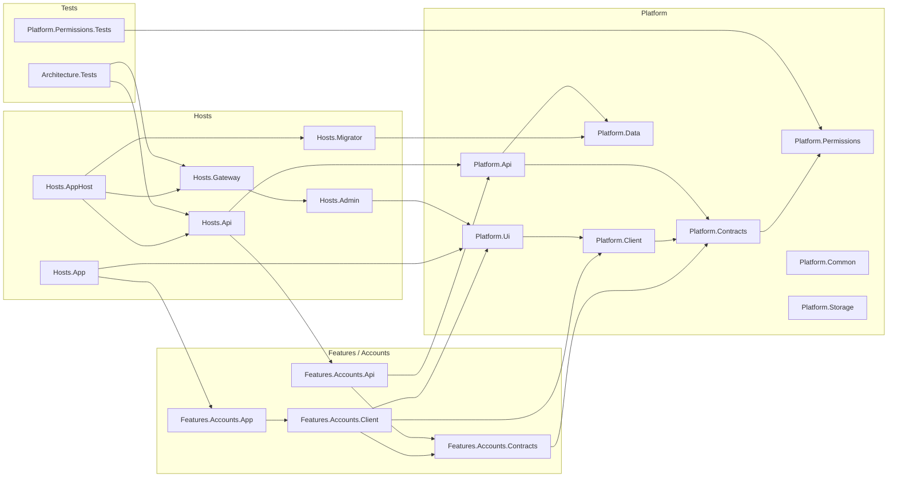
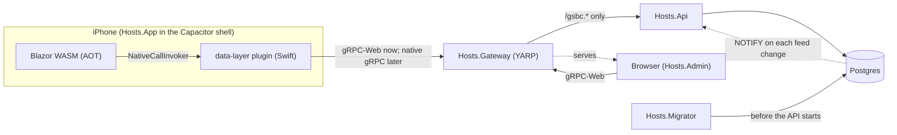

# Repo layout

Decided 2026-11-01: feature-first, with solution folders that mirror the file system.

```
GSBC.ChurchApp.slnx            solution folders = the folders below
Directory.Build.props          shared settings, the AOT rules (SPEC §9)
Directory.Build.targets        AOT scope per project kind, trimmer rooting for page modules
Directory.Packages.props       every package version, in one place
global.json                    the SDK (10.0.401, Homebrew's; SPEC §9)

src/
  Platform/                    what every feature stands on; never feature code
    GSBC.ChurchApp.Platform.Common          (AOT) church time, small shared types
    GSBC.ChurchApp.Platform.Permissions     (AOT) permission nodes, scopes, the matcher
    GSBC.ChurchApp.Platform.Contracts       (AOT) Sync contracts, service tiers
    GSBC.ChurchApp.Platform.Client          (AOT) module registration, sync reader, access checks
    GSBC.ChurchApp.Platform.Ui              (AOT) the shared component library
    GSBC.ChurchApp.Platform.Api             gRPC hosting, tiers, access enforcement, Sync
    GSBC.ChurchApp.Platform.Data            EF Core conventions, the feed change log, NOTIFY
    GSBC.ChurchApp.Platform.Storage         S3-compatible blobs (R2), Dropbox
  Features/
    Accounts/                  sign-in state, passkeys, sessions, invitations
    Access/                    roles, assignments, the permission catalogue
    <Feature>/
      GSBC.ChurchApp.Features.<Feature>.Contracts   (AOT) messages, [Service] interfaces, permissions
      GSBC.ChurchApp.Features.<Feature>.Api         services, EF Core, feeds
      GSBC.ChurchApp.Features.<Feature>.Client      (AOT) calls, feed readers, shared components
      GSBC.ChurchApp.Features.<Feature>.App         (AOT) phone pages
      GSBC.ChurchApp.Features.<Feature>.Admin       (AOT-checked) desktop staff pages
  Hosts/
    GSBC.ChurchApp.Hosts.Gateway            YARP BFF, passkey ceremonies, serves Admin
    GSBC.ChurchApp.Hosts.Api                cluster-internal gRPC API
    GSBC.ChurchApp.Hosts.Migrator           applies every feature's migrations, then exits
    GSBC.ChurchApp.Hosts.Admin              Blazor WASM, not AOT
    GSBC.ChurchApp.Hosts.AppHost            Aspire, local development only
    App/
      GSBC.ChurchApp.Hosts.App              Blazor WASM AOT
      shell/                                Capacitor (iOS now; Android later)
      native/data-layer/                    the one native plugin (SPEC §5)

tests/                         mirrors src/
  Architecture/GSBC.ChurchApp.Architecture.Tests     the rules below, as tests
  Platform/GSBC.ChurchApp.Platform.<X>.Tests
  Features/<Feature>/GSBC.ChurchApp.Features.<Feature>.<Part>.Tests

tools/aot-warnings/            check.sh publishes the app and checks its warning baseline (SPEC §9)
.config/dotnet-tools.json      dotnet-ef
docs/                          architecture/, features/ (one per feature), the spec's detail
spikes/                        frozen; reference only, not in the solution
reference/                     gitignored; the church's own files (logo pack, flyers, site plan)
```

## The projects

Kept current by `Architecture.Tests` (`ProjectMapRules`): a project missing from the diagram or the
table below, or listed here but gone, fails the build. Arrows are project references.



At run time:



| Project | What it is and does | AOT |
|---|---|---|
| `GSBC.ChurchApp.Platform.Common` | Church time (`Australia/Brisbane`) and small shared types. Not referenced yet | Yes |
| `GSBC.ChurchApp.Platform.Permissions` | Permission nodes, scopes, patterns and the grant matcher; the same code decides on server and phone | Yes |
| `GSBC.ChurchApp.Platform.Contracts` | Tier attributes (`[Public]`, `[SignedIn]`, `[Requires]`, `[AppInstall]`) and the Sync service contract | Yes |
| `GSBC.ChurchApp.Platform.Client` | Client plumbing: module registry, `IAccess`, the gRPC-Web channel and the native bridge (`NativeCallInvoker`) | Yes |
| `GSBC.ChurchApp.Platform.Ui` | The shared component library: `ModuleRouter`, `ModuleNav`, the `Can` permission gate | Yes |
| `GSBC.ChurchApp.Platform.Api` | Server plumbing: gRPC hosting and ports, the fail-closed tier interceptor, the permission catalogue, feeds and the Sync service, health | No |
| `GSBC.ChurchApp.Platform.Data` | EF Core base for feature schemas, the `sync.feed_changes` log and its `NOTIFY` trigger, migration targets | No |
| `GSBC.ChurchApp.Platform.Storage` | `IBlobStore` over the S3 API (R2) and content addressing. Not referenced yet | No |
| `GSBC.ChurchApp.Features.Accounts.Contracts` | The `Session` service contract and Accounts' permission nodes | Yes |
| `GSBC.ChurchApp.Features.Accounts.Api` | `SessionService`: who is calling | No |
| `GSBC.ChurchApp.Features.Accounts.Client` | Accounts' generated gRPC proxies and `AccountsClient` | Yes |
| `GSBC.ChurchApp.Features.Accounts.App` | The phone's Account page and its navigation entry | Yes |
| `GSBC.ChurchApp.Hosts.App` | The phone app: Blazor WASM, AOT in Release, packaged by `shell/` with `native/data-layer` | Yes |
| `GSBC.ChurchApp.Hosts.Admin` | The staff admin panel: Blazor WASM, not AOT, served by the gateway | No |
| `GSBC.ChurchApp.Hosts.Gateway` | The only public entry: proxies gRPC and gRPC-Web to the API, serves the admin panel; passkeys later | No |
| `GSBC.ChurchApp.Hosts.Api` | The cluster-internal gRPC API: maps every feature's services | No |
| `GSBC.ChurchApp.Hosts.Migrator` | Applies every feature's migrations, then exits | No |
| `GSBC.ChurchApp.Hosts.AppHost` | Aspire, local development only: Postgres, migrator, API and gateway together | No |
| `GSBC.ChurchApp.Architecture.Tests` | The rules: feature isolation, gRPC-only endpoints, one tier per method, this map | No |
| `GSBC.ChurchApp.Platform.Permissions.Tests` | How grants resolve: scope, most specific wins, deny wins a tie | No |

Not .NET projects: `src/Hosts/App/shell` (the Capacitor iOS project) and `src/Hosts/App/native/data-layer`
(the Capacitor plugin: Swift now, Kotlin stubbed until Android).

## Naming

`GSBC.ChurchApp.<Area>.<Name>[.<Part>]`. The folder is the project name, and the root namespace is
the project name. A solution folder exists only where a file-system folder does.

## A feature's parts

A feature has only the parts it needs.

| Part | Holds | References | Ships in |
|---|---|---|---|
| **Contracts** | Messages, `[Service]` interfaces, `[ProtoModel]`, its permission nodes and feed names | Platform.Contracts, Platform.Permissions | Everything |
| **Api** | Service implementations, its `DbContext` and migrations, its feeds, its seeded roles | Its Contracts, Platform.Api, Platform.Data, Platform.Storage | Hosts.Api, Hosts.Migrator |
| **Client** | Its `[ProtoGrpc]`, typed calls, feed readers, and every component shown in more than one host | Its Contracts, Platform.Client, Platform.Ui | App, Admin |
| **App** | Phone pages and navigation entries | Its Client | Hosts.App |
| **Admin** | Desktop-only staff pages (bulk editing, configuration) | Its Client | Hosts.Admin |

**Admin isn't a host, it's a permission** (requirement A). A Life Group leader editing their group's
notices on the phone and a staff member doing it in the browser use the same component, from the
feature's Client, shown wherever the user holds the permission. Admin only holds what genuinely
needs a desk: wide tables, bulk edits, configuration. So:

- a management component starts in Client, gated by a permission check, never in App or Admin;
- moving a component from Admin to the phone is a page change, not a rewrite;
- the server enforces every permission; hiding UI is a courtesy.

## Rules, enforced by `Architecture.Tests`

- Features never reference each other, only Platform. Cross-feature display goes through a small
  interface in Platform (the home card pattern, SPEC §8).
- Platform never references a feature.
- Every server endpoint is a gRPC method, static files, or an approved path in AGENTS.md. gRPC's
  catch-all "unknown service" endpoints are switched off (`IgnoreUnknownServices`), so at the
  gateway they can't swallow calls meant for the proxy.
- Every gRPC method declares exactly one tier, and any permission it names exists (SPEC §6,
  [permissions.md](permissions.md)).
- [The projects](#the-projects) lists every project, and its diagram's arrows are the real project
  references.

Not tests, because the build does them by project name, so a new module can't forget:
`Directory.Build.props` puts the app's projects in AOT scope (`IsAotCompatible`), `Directory.Build.targets`
roots every `.App` module the app host references for the trimmer, and every `.Contracts` project gets
`CompatibilityLevel.Level300`.

## Hosts and ports

The API and the gateway each listen on two ports, because h2c can't share one with HTTP/1.1
(SPEC §10): `Ports:Web` (HTTP/1.1 + HTTP/2, gRPC-Web and the admin panel) and `Ports:Grpc` (HTTP/2
only, native gRPC). Containers use 8080/8081; locally the gateway is 5300/5301. The gateway sends
`/gsbc.{service}/{method}` to the API by content type, gRPC-Web to its web port and gRPC to its gRPC
port, and nothing else.

## Adding a feature

1. Create `src/Features/<Feature>/` with the parts it needs, named as above, and add them to the
   solution under the same folders.
2. Contracts: services named `gsbc.<feature>.<Service>` (the gateway only routes `/gsbc.*`), a tier
   attribute on every method, permission nodes in a static class, a `[ProtoModel]`.
3. Api: `AddXxxApi()` registers its permissions, feeds and `DbContext` (its own schema, via
   `AddFeatureDbContext`); `MapXxxApi()` maps its services. Add both to Hosts.Api, and its data to
   Hosts.Migrator.
4. Client/App/Admin: `AddXxxApp()` / `AddXxxAdmin()` registers pages, navigation and surfaces.
5. Write `docs/features/<feature>.md` before the code. Add tests where a rule would otherwise go
   unguarded; not for coverage.
6. Add the projects to `GSBC.ChurchApp.slnx` under folders that match their paths.
7. Add each project, and its references as arrows, to [The projects](#the-projects).
