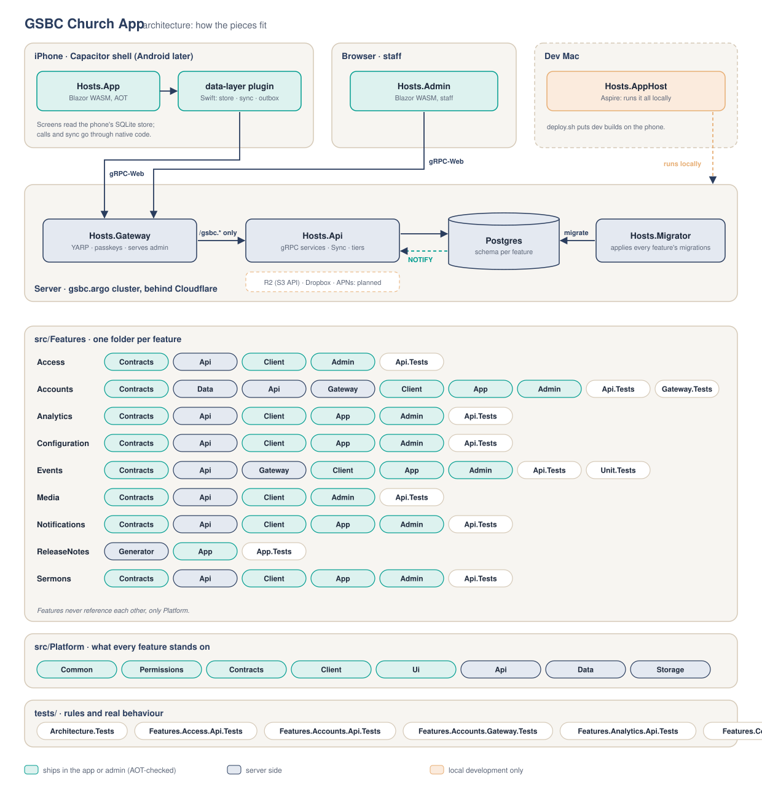
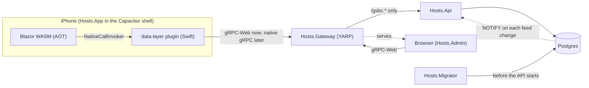

# Repo layout

Decided 2026-11-01: feature-first, with solution folders that mirror the file system.

```
GSBC.ChurchApp.slnx            solution folders = the folders below
Directory.Build.props          shared settings, the AOT rules (SPEC §9)
Directory.Build.targets        AOT scope per project kind, trimmer rooting for page modules
Directory.Packages.props       every package version, in one place
global.json                    the SDK (10.0.401, Homebrew's; SPEC §9)

src/
  Platform/                    what every feature stands on; never feature code
    GSBC.ChurchApp.Platform.Common          (AOT) church time, small shared types
    GSBC.ChurchApp.Platform.Permissions     (AOT) permission nodes, scopes, the matcher
    GSBC.ChurchApp.Platform.Contracts       (AOT) Sync contracts, service tiers
    GSBC.ChurchApp.Platform.Client          (AOT) module registration, sync reader, access checks
    GSBC.ChurchApp.Platform.Ui              (AOT) the shared component library
    GSBC.ChurchApp.Platform.Api             gRPC hosting, tiers, access enforcement, Sync
    GSBC.ChurchApp.Platform.Data            EF Core conventions, the feed change log, NOTIFY
    GSBC.ChurchApp.Platform.Storage         S3-compatible blobs (R2), Dropbox
  Features/
    Accounts/                  sign-in state, passkeys, sessions, invitations
    Access/                    roles, assignments, the permission catalogue
    <Feature>/
      GSBC.ChurchApp.Features.<Feature>.Contracts   (AOT) messages, [Service] interfaces, permissions
      GSBC.ChurchApp.Features.<Feature>.Api         services, EF Core, feeds
      GSBC.ChurchApp.Features.<Feature>.Client      (AOT) calls, feed readers, shared components
      GSBC.ChurchApp.Features.<Feature>.App         (AOT) phone pages
      GSBC.ChurchApp.Features.<Feature>.Admin       (AOT-checked) desktop staff pages
  Hosts/
    GSBC.ChurchApp.Hosts.Gateway            YARP BFF, passkey ceremonies, serves Admin
    GSBC.ChurchApp.Hosts.Api                cluster-internal gRPC API
    GSBC.ChurchApp.Hosts.Migrator           applies every feature's migrations, then exits
    GSBC.ChurchApp.Hosts.Admin              Blazor WASM, not AOT
    GSBC.ChurchApp.Hosts.AppHost            Aspire, local development only
    App/
      GSBC.ChurchApp.Hosts.App              Blazor WASM AOT
      shell/                                Capacitor (iOS now; Android later); ios/environments/ per app
      native/data-layer/                    the one native plugin (SPEC §5)

tests/                         mirrors src/
  Architecture/GSBC.ChurchApp.Architecture.Tests     the rules below, as tests
  Platform/GSBC.ChurchApp.Platform.<X>.Tests
  Features/<Feature>/GSBC.ChurchApp.Features.<Feature>.<Part>.Tests

tools/aot-warnings/            check.sh publishes the app and checks its warning baseline (SPEC §9)
tools/containers/              publish.sh builds the API, gateway and migrator images (environments.md)
.config/dotnet-tools.json      dotnet-ef
docs/                          architecture/, features/ (one per feature), the spec's detail
spikes/                        frozen; reference only, not in the solution
reference/                     gitignored; the church's own files (logo pack, flyers, site plan)
```

## The projects



The picture is drawn from the projects on disk by `tools/docs/architecture.py`; run it after adding,
removing or renaming a project. `Architecture.Tests` (`ProjectMapRules`) keeps all of this current: a
project missing from the picture, the diagram or the table below, or shown but gone, fails the
build. In the diagram below, arrows are project references.

```mermaid
flowchart LR
    subgraph Hosts
        HostsApp["Hosts.App"]
        HostsAdmin["Hosts.Admin"]
        HostsGateway["Hosts.Gateway"]
        HostsApi["Hosts.Api"]
        HostsMigrator["Hosts.Migrator"]
        HostsAppHost["Hosts.AppHost"]
    end

    subgraph Accounts["Features / Accounts"]
        AccountsApp["Features.Accounts.App"]
        AccountsAdmin["Features.Accounts.Admin"]
        AccountsClient["Features.Accounts.Client"]
        AccountsApi["Features.Accounts.Api"]
        AccountsData["Features.Accounts.Data"]
        AccountsGateway["Features.Accounts.Gateway"]
        AccountsContracts["Features.Accounts.Contracts"]
    end

    subgraph Access["Features / Access"]
        AccessAdmin["Features.Access.Admin"]
        AccessClient["Features.Access.Client"]
        AccessApi["Features.Access.Api"]
        AccessContracts["Features.Access.Contracts"]
    end

    subgraph Configuration["Features / Configuration"]
        ConfigurationApp["Features.Configuration.App"]
        ConfigurationAdmin["Features.Configuration.Admin"]
        ConfigurationClient["Features.Configuration.Client"]
        ConfigurationApi["Features.Configuration.Api"]
        ConfigurationContracts["Features.Configuration.Contracts"]
    end

    subgraph Media["Features / Media"]
        MediaAdmin["Features.Media.Admin"]
        MediaClient["Features.Media.Client"]
        MediaApi["Features.Media.Api"]
        MediaContracts["Features.Media.Contracts"]
    end

    subgraph Analytics["Features / Analytics"]
        AnalyticsApp["Features.Analytics.App"]
        AnalyticsAdmin["Features.Analytics.Admin"]
        AnalyticsClient["Features.Analytics.Client"]
        AnalyticsApi["Features.Analytics.Api"]
        AnalyticsContracts["Features.Analytics.Contracts"]
    end

    subgraph Notifications["Features / Notifications"]
        NotificationsApp["Features.Notifications.App"]
        NotificationsAdmin["Features.Notifications.Admin"]
        NotificationsClient["Features.Notifications.Client"]
        NotificationsApi["Features.Notifications.Api"]
        NotificationsContracts["Features.Notifications.Contracts"]
    end

    subgraph ReleaseNotes["Features / ReleaseNotes"]
        ReleaseNotesApp["Features.ReleaseNotes.App"]
        ReleaseNotesGenerator["Features.ReleaseNotes.Generator"]
    end

    subgraph Platform
        PlatformUi["Platform.Ui"]
        PlatformClient["Platform.Client"]
        PlatformApi["Platform.Api"]
        PlatformData["Platform.Data"]
        PlatformContracts["Platform.Contracts"]
        PlatformPermissions["Platform.Permissions"]
        PlatformCommon["Platform.Common"]
        PlatformStorage["Platform.Storage"]
    end

    subgraph Tests
        ArchitectureTests["Architecture.Tests"]
        PermissionsTests["Platform.Permissions.Tests"]
        ContractsTests["Platform.Contracts.Tests"]
        ApiTests["Platform.Api.Tests"]
        GatewayTests["Features.Accounts.Gateway.Tests"]
        AccountsApiTests["Features.Accounts.Api.Tests"]
        AccessTests["Features.Access.Api.Tests"]
        ConfigurationTests["Features.Configuration.Api.Tests"]
        MediaTests["Features.Media.Api.Tests"]
        AnalyticsTests["Features.Analytics.Api.Tests"]
        NotificationsTests["Features.Notifications.Api.Tests"]
        ReleaseNotesTests["Features.ReleaseNotes.App.Tests"]
    end

    HostsAppHost --> HostsApi & HostsGateway & HostsMigrator
    HostsGateway --> HostsAdmin & AccountsGateway
    HostsApp --> AccountsApp & AccessClient & ConfigurationApp & PlatformUi & MediaClient & ReleaseNotesApp & AnalyticsApp & NotificationsApp
    HostsAdmin --> PlatformUi & AccountsAdmin & AccessAdmin & ConfigurationAdmin & MediaAdmin & AnalyticsAdmin & NotificationsAdmin
    HostsApi --> AccountsApi & AccessApi & ConfigurationApi & MediaApi & AnalyticsApi & NotificationsApi & PlatformApi
    HostsMigrator --> PlatformData & AccountsData & AccessApi & ConfigurationApi & MediaApi & AnalyticsApi & NotificationsApi

    AccountsApp --> AccountsClient
    AccountsAdmin --> AccountsClient
    AccountsClient --> AccountsContracts & PlatformClient & PlatformUi
    AccountsApi --> AccountsContracts & AccountsData & PlatformApi
    AccountsGateway --> AccountsData
    AccountsContracts --> PlatformContracts
    AccountsData --> PlatformData & AccountsContracts

    AccessAdmin --> AccessClient
    AccessClient --> AccessContracts & PlatformClient & PlatformUi
    AccessApi --> AccessContracts & PlatformApi
    AccessContracts --> PlatformContracts

    ConfigurationApp --> ConfigurationClient
    ConfigurationAdmin --> ConfigurationClient
    ConfigurationClient --> ConfigurationContracts & PlatformClient & PlatformUi & PlatformCommon
    ConfigurationApi --> ConfigurationContracts & PlatformApi
    ConfigurationContracts --> PlatformContracts
    MediaAdmin --> MediaClient
    MediaClient --> MediaContracts & PlatformClient & PlatformUi
    MediaApi --> MediaContracts & PlatformApi & PlatformStorage
    MediaContracts --> PlatformContracts
    NotificationsApp --> NotificationsClient
    NotificationsAdmin --> NotificationsClient
    NotificationsClient --> NotificationsContracts & PlatformClient & PlatformUi & PlatformCommon
    NotificationsApi --> NotificationsContracts & PlatformApi & PlatformCommon
    NotificationsContracts --> PlatformContracts

    AnalyticsApp --> AnalyticsClient
    AnalyticsAdmin --> AnalyticsClient
    AnalyticsClient --> AnalyticsContracts & PlatformClient & PlatformUi & PlatformCommon
    AnalyticsApi --> AnalyticsContracts & PlatformApi & PlatformCommon
    AnalyticsContracts --> PlatformContracts

    ReleaseNotesApp --> PlatformUi & ReleaseNotesGenerator

    PlatformUi --> PlatformClient & PlatformCommon
    PlatformClient --> PlatformContracts
    PlatformApi --> PlatformContracts & PlatformData
    PlatformContracts --> PlatformPermissions

    ArchitectureTests --> HostsApi & HostsGateway & PlatformUi
    PermissionsTests --> PlatformPermissions
    ContractsTests --> PlatformContracts
    ApiTests --> PlatformApi & PlatformClient
    GatewayTests --> AccountsGateway
    AccountsApiTests --> AccountsApi
    AccessTests --> AccessApi
    ConfigurationTests --> ConfigurationApi
    MediaTests --> MediaApi
    AnalyticsTests --> AnalyticsApi
    NotificationsTests --> NotificationsApi
    ReleaseNotesTests --> ReleaseNotesApp & ReleaseNotesGenerator
```



At run time:



| Project | What it is and does | AOT |
|---|---|---|
| `GSBC.ChurchApp.Platform.Common` | Church time (`Australia/Brisbane`) and small shared types | Yes |
| `GSBC.ChurchApp.Platform.Permissions` | Permission nodes, scopes, patterns and the grant matcher; the same code decides on server and phone | Yes |
| `GSBC.ChurchApp.Platform.Contracts` | Tier attributes (`[Public]`, `[SignedIn]`, `[Requires]`, `[AppInstall]`), the Sync service contract, and configuration's descriptors (areas, surfaces, setting fields, audiences, layout composition, and the Hub area), `MediaRef` (how any feature's record points at an image or file), and rich text (`RichText`, its parser and save rules) | Yes |
| `GSBC.ChurchApp.Platform.Client` | Client plumbing: module registry and startup tasks, `IAccess`, the session signal and `IPeopleDirectory` (how features cooperate without referencing each other), the native bridge, local feed reads (`ILocalFeeds`), the outbox (`IOutbox`, with quiet entries that never show), `IClientDiagnostics` and `CurrentPage` (errors and failed calls, seen by the channel every feature calls through), `ISurfaceLayout` (an area as staff arranged it), `ClientSignals` (every change the client knows about, in one event), and media files (`IMediaFiles`: the phone's file cache, or the URL in a browser; `MediaPrefetch` rules; the `MediaPicker` registration) | Yes |
| `GSBC.ChurchApp.Platform.Ui` | The design system: tokens, fonts and the mark (static web assets both hosts link), the phone shell (`Page`, `Masthead`, `ModuleNav` as tab bar or More list, `ModuleRouter`), `LiveData` and `RefreshOn` (screens that update themselves), generic building blocks (`Section`, `Card`, `ListGroup`/`ListRow`, `PullToRefresh`, `Sheet`, `EmptyState`, `DateLine`, `SyncIndicator`, `Button`, fields, `Segmented`, `Skeleton`), the theme (`AppTheme`, `Appearance`), the `Can` permission gate, `MediaImage`, and in `Content/` `RichTextView`, `RichTextEditor` and `MediaChooser` | Yes |
| `GSBC.ChurchApp.Platform.Api` | Server plumbing: gRPC hosting and ports, the fail-closed tier interceptor, the permission catalogue and system roles, feeds, the Sync service, one `LISTEN` connection for every notification channel, email delivery, rate limits, health, `IPermissionHolders` and `IAccountEmails` (who holds a node, and their addresses), and `IMediaReferences` (the check features call on every `MediaRef` they save) | No |
| `GSBC.ChurchApp.Platform.Data` | EF Core base for feature schemas, the `sync.feed_changes` log and its `NOTIFY` trigger, the outgoing-email queue, migration targets | No |
| `GSBC.ChurchApp.Platform.Storage` | `IBlobStore` over the S3 API (R2 in production, SeaweedFS in development): public and private buckets, signed links, copies with cache headers, content-addressed keys | No |
| `GSBC.ChurchApp.Features.Accounts.Contracts` | The `Session` service contract and Accounts' permission nodes | Yes |
| `GSBC.ChurchApp.Features.Accounts.Data` | The `accounts` schema: Identity users and passkeys, sessions, one-time codes, audit log; shared by the API and the gateway | No |
| `GSBC.ChurchApp.Features.Accounts.Api` | `SessionService` (who is calling) and `AccountsService` (sign-up, recovery, profile, passkeys, sessions, invitations); validates the gateway's tokens | No |
| `GSBC.ChurchApp.Features.Accounts.Gateway` | The passkey ceremonies (the approved non-gRPC paths), server-side sessions, and the session-to-token swap on every proxied call | No |
| `GSBC.ChurchApp.Features.Accounts.Client` | Accounts' generated gRPC proxies, `AccountsClient`, the browser passkey ceremonies, and the shared `SignIn`, `Welcome` and `AccountDetails` components | Yes |
| `GSBC.ChurchApp.Features.Accounts.App` | The phone's Account page and its navigation entry | Yes |
| `GSBC.ChurchApp.Features.Accounts.Admin` | The admin panel's Account and Welcome pages, built from the Client's components | Yes |
| `GSBC.ChurchApp.Features.Access.Contracts` | The `Access` service, its messages and the `access.*` permission nodes | Yes |
| `GSBC.ChurchApp.Features.Access.Api` | Roles, assignments and the catalogue (schema `access`); the cached `AccessEvaluator` behind every `[Requires]`; reconciling system roles; the escalation and last-owner guards | No |
| `GSBC.ChurchApp.Features.Access.Client` | Access's gRPC proxies, and loading your grants into `IAccess`: from `Access.GetMine` in the admin panel, from the private `access.grants` feed on the phone (offline too) | Yes |
| `GSBC.ChurchApp.Features.Access.Admin` | The Roles and Who-holds-what pages | Yes |
| `GSBC.ChurchApp.Features.Configuration.Contracts` | The `Configuration` service, its messages and the placements feed | Yes |
| `GSBC.ChurchApp.Features.Configuration.Api` | Placements and their audit (schema `config`): validates against descriptors, checks each area's permission, writes the feed, rolls back | No |
| `GSBC.ChurchApp.Features.Configuration.Client` | The gRPC proxies, `ISurfaceLayout` over the phone's store, and the generic `SurfaceEditor` | Yes |
| `GSBC.ChurchApp.Features.Configuration.App` | The phone's Arrange page and its navigation entry | Yes |
| `GSBC.ChurchApp.Features.Configuration.Admin` | The admin panel's Arrange page and its navigation entry | Yes |
| `GSBC.ChurchApp.Features.Media.Contracts` | The `Media` service, its messages, the accepted file types and the `media.*` permission nodes | Yes |
| `GSBC.ChurchApp.Features.Media.Api` | Uploads through signed R2 links, checked and named by their SHA-256, with dimensions read from the bytes; signed links to private media for whoever holds its audience; `IMediaReferences` and which records use which file; deleting unused files (schema `media`) | No |
| `GSBC.ChurchApp.Features.Media.Client` | Media's gRPC proxies, uploading, private links behind `IPrivateMediaLinks`, and the shared `MediaUpload` and `MediaLibrary` components (`MediaLibrary` is also the `MediaPicker`) | Yes |
| `GSBC.ChurchApp.Features.Media.Admin` | The Media library page | Yes |
| `GSBC.ChurchApp.Features.Analytics.Contracts` | The `Diagnostics` and `Health` services, their messages, `StackSummary` (an exception's type and our method names, with no paths or messages) and the `analytics.*` permission nodes | Yes |
| `GSBC.ChurchApp.Features.Analytics.Api` | Error reports grouped into kinds, failed calls from the server's own interceptor and from the phones, an email to `analytics.health.view` holders when a new kind appears, the Insights viewer role, and pruning (schema `analytics`) | No |
| `GSBC.ChurchApp.Features.Analytics.Client` | The error reporter behind `IClientDiagnostics` (unhandled exceptions, failed calls, native crashes, sent through the quiet outbox on the phone), the "Help improve the app" consent, and Analytics' gRPC proxies | Yes |
| `GSBC.ChurchApp.Features.Analytics.App` | The phone's "Help improve the app" page: the switch and the privacy notice | Yes |
| `GSBC.ChurchApp.Features.Analytics.Admin` | The App health and Insights pages (admin panel only) | Yes |
| `GSBC.ChurchApp.Features.Notifications.Contracts` | The `Notifications` and `Announcements` services, the inbox, kinds and preferences feeds, the announcement kinds and the `notifications.announcements.*` permission nodes | Yes |
| `GSBC.ChurchApp.Features.Notifications.Api` | `INotifications`: audiences through Access, the inbox feeds, preferences, pacing, quiet hours; push through APNs with retries and dead tokens dropped; the silent push for sync; announcements and their schedule (schema `notifications`) | No |
| `GSBC.ChurchApp.Features.Notifications.Client` | The inbox (`Inbox`, also the bell's `IInboxCount`), push registration, preferences, and the shared `InboxView`, `NotificationSettings` and `AnnouncementsWorkbench` components | Yes |
| `GSBC.ChurchApp.Features.Notifications.App` | The phone's Notifications list (from the bell) and More → Notifications | Yes |
| `GSBC.ChurchApp.Features.Notifications.Admin` | The Announcements page | Yes |
| `GSBC.ChurchApp.Features.ReleaseNotes.Generator` | Build time only: a source generator that reads `changelog/`, checks every note, and writes the notes for this build's audience (staff for dev and UAT, everyone for Release) into the app as C# ([changelog.md](changelog.md)) | No (runs in the compiler) |
| `GSBC.ChurchApp.Features.ReleaseNotes.App` | What's new: the highlights shown once after an update, and the What's new page under More, from the notes built into the app | Yes |
| `GSBC.ChurchApp.Hosts.App` | The phone app: Blazor WASM, AOT in Release, packaged by `shell/` with `native/data-layer` | Yes |
| `GSBC.ChurchApp.Hosts.Admin` | The staff admin panel: Blazor WASM, not AOT, served by the gateway | No |
| `GSBC.ChurchApp.Hosts.Gateway` | The only public entry: proxies gRPC and gRPC-Web to the API with a short-lived token, serves the admin panel, hosts the passkey ceremonies | No |
| `GSBC.ChurchApp.Hosts.Api` | The cluster-internal gRPC API: maps every feature's services | No |
| `GSBC.ChurchApp.Hosts.Migrator` | Applies every feature's migrations, then exits | No |
| `GSBC.ChurchApp.Hosts.AppHost` | Aspire, local development only: Postgres, a SeaweedFS S3 store for media, migrator, API and gateway together, plus the Cloudflare tunnel when this Mac has one | No |
| `GSBC.ChurchApp.Architecture.Tests` | The rules: feature isolation, gRPC-only endpoints, one tier per method, this map | No |
| `GSBC.ChurchApp.Platform.Permissions.Tests` | How grants resolve: scope, most specific wins, deny wins a tie | No |
| `GSBC.ChurchApp.Features.Accounts.Gateway.Tests` | The real passkey ceremonies with a software authenticator, against Postgres: sign-up, sign-in, tokens, ending sessions, replay, origin, disabled accounts | No |
| `GSBC.ChurchApp.Features.Accounts.Api.Tests` | Against Postgres: a review sign-in code works only while live, never reaches an account that isn't a demo account, and wrong guesses are throttled. App Attest: a genuine attestation is accepted, and refused for another challenge, app or root; an assertion only for its own request, once | No |
| `GSBC.ChurchApp.Features.Access.Api.Tests` | Against Postgres: scopes, includes, denies and expiry decide access; nobody can hand out permissions they don't hold | No |
| `GSBC.ChurchApp.Features.Configuration.Api.Tests` | Against Postgres: only the area's permission at its scope arranges it; descriptors validate every value; saves reach the feed; stale saves are refused; rollback restores; images in settings are the library's; unsafe rich text is never stored | No |
| `GSBC.ChurchApp.Features.Media.Api.Tests` | Against Postgres and an S3 store (in containers): a file's name is its content, files that aren't what they claim are refused, private media is only linked while you hold its audience, a saved `MediaRef` is the library's, dimensions come from the bytes, files in use can't be deleted | No |
| `GSBC.ChurchApp.Features.Analytics.Api.Tests` | Against Postgres: one kind per error however many phones report it, a resent report counts once, the owner hears once per new kind, only the app and admin panel may report and only about recent days, failed calls add up, errors go after 30 days; stack summaries keep no paths or build numbers | No |
| `GSBC.ChurchApp.Features.Notifications.Api.Tests` | Against Postgres: a notification about a thing must link to it, followers and members hear from their ministry (a phone without signing in), preferences stop the push but not the inbox and safety notices always push, overnight pushes wait unless urgent, pacing collapses into a summary, dead tokens are dropped and failures retried, reading reaches the other devices | No |
| `GSBC.ChurchApp.Platform.Api.Tests` | Against a real Postgres (in a container): Sync's pruning, compaction and resets converge every phone; the admin panel's live watch hears only what it may see, catches up after a drop, and a stream ends with its sign-in; queued email waits out its backoff and then goes | No |
| `GSBC.ChurchApp.Features.ReleaseNotes.App.Tests` | Highlights show once after an update and never on a fresh install; a production build carries no staff notes or staff wording | No |
| `GSBC.ChurchApp.Platform.Contracts.Tests` | Sync's wire format, pinned as bytes the Swift codec's tests decode too; how the phone composes an area from defaults, placements, dates and audience; rich text refuses unsafe links and foreign images, and HTML is only text | No |

Not .NET projects: `src/Hosts/App/shell` (the Capacitor iOS project) and `src/Hosts/App/native/data-layer`
(the Capacitor plugin: `DataLayerCore` holds the gRPC-Web transport, GRDB store, sync engine and outbox,
the media file cache, with its own tests (`xcodebuild test -scheme GsbcDataLayer`); `DataLayerPlugin` is the thin Capacitor
bridge over it; Kotlin is stubbed until Android).

## Naming

`GSBC.ChurchApp.<Area>.<Name>[.<Part>]`. The folder is the project name, and the root namespace is
the project name. A solution folder exists only where a file-system folder does.

## A feature's parts

A feature has only the parts it needs.

| Part | Holds | References | Ships in |
|---|---|---|---|
| **Contracts** | Messages, `[Service]` interfaces, `[ProtoModel]`, its permission nodes and feed names | Platform.Contracts, Platform.Permissions | Everything |
| **Data** (optional) | Its `DbContext` and migrations, when the gateway needs the same state as the API (only Accounts so far) | Platform.Data | Api, Gateway, Hosts.Migrator |
| **Api** | Service implementations, its `DbContext` and migrations (or its Data part's), its feeds, its seeded roles | Its Contracts, Platform.Api, Platform.Data, Platform.Storage | Hosts.Api, Hosts.Migrator |
| **Generator** (optional) | A source generator the feature's own projects run at build time (only ReleaseNotes so far) | Roslyn only | Nothing: it runs in the compiler |
| **Gateway** (optional) | What the feature needs at the gateway: Accounts' passkey ceremonies and sessions | Its Contracts and Data | Hosts.Gateway |
| **Client** | Its `[ProtoGrpc]`, typed calls, feed readers, and every component shown in more than one host | Its Contracts, Platform.Client, Platform.Ui | App, Admin |
| **App** | Phone pages and navigation entries | Its Client | Hosts.App |
| **Admin** | Desktop-only staff pages (bulk editing, configuration) | Its Client | Hosts.Admin |

**Admin isn't a host, it's a permission** (requirement A). A Life Group leader editing their group's
notices on the phone and a staff member doing it in the browser use the same component, from the
feature's Client, shown wherever the user holds the permission. Admin only holds what genuinely
needs a desk: wide tables, bulk edits, configuration. So:

- a management component starts in Client, gated by a permission check, never in App or Admin;
- moving a component from Admin to the phone is a page change, not a rewrite;
- the server enforces every permission; hiding UI is a courtesy.

## Rules, enforced by `Architecture.Tests`

- Features never reference each other, only Platform. Cross-feature display goes through a small
  interface in Platform (the home card pattern, SPEC §8).
- Platform never references a feature.
- Every server endpoint is a gRPC method, static files, or an approved path in AGENTS.md. gRPC's
  catch-all "unknown service" endpoints are switched off (`IgnoreUnknownServices`), so at the
  gateway they can't swallow calls meant for the proxy.
- Every gRPC method declares exactly one tier, and any permission it names exists (SPEC §6,
  [permissions.md](permissions.md)).
- [The projects](#the-projects) lists every project, and its diagram's arrows are the real project
  references.

Not tests, because the build does them by project name, so a new module can't forget:
`Directory.Build.props` puts the app's projects in AOT scope (`IsAotCompatible`), `Directory.Build.targets`
roots every `.App` module the app host references for the trimmer, and every `.Contracts` project gets
`CompatibilityLevel.Level300`.

## Hosts and ports

The API and the gateway each listen on two ports, because h2c can't share one with HTTP/1.1
(SPEC §10): `Ports:Web` (HTTP/1.1 + HTTP/2, gRPC-Web and the admin panel) and `Ports:Grpc` (HTTP/2
only, native gRPC). Containers use 8080/8081; locally the gateway is 5300/5301. The gateway sends
`/gsbc.{service}/{method}` to the API by content type, gRPC-Web to its web port and gRPC to its gRPC
port, and nothing else.

## Adding a feature

1. Create `src/Features/<Feature>/` with the parts it needs, named as above, and add them to the
   solution under the same folders.
2. Contracts: services named `gsbc.<feature>.<Service>` (the gateway only routes `/gsbc.*`), a tier
   attribute on every method, permission nodes in a static class, a `[ProtoModel]`.
3. Api: `AddXxxApi()` registers its permissions, feeds and `DbContext` (its own schema, via
   `AddFeatureDbContext`); `MapXxxApi()` maps its services. Add both to Hosts.Api, and its data to
   Hosts.Migrator.
4. Client/App/Admin: `AddXxxApp()` / `AddXxxAdmin()` registers pages, navigation and surfaces.
5. Write `docs/features/<feature>.md` before the code. Add tests where a rule would otherwise go
   unguarded; not for coverage.
6. Add the projects to `GSBC.ChurchApp.slnx` under folders that match their paths.
7. Add each project, and its references as arrows, to [The projects](#the-projects), and run
   `tools/docs/architecture.py` to redraw the picture.
